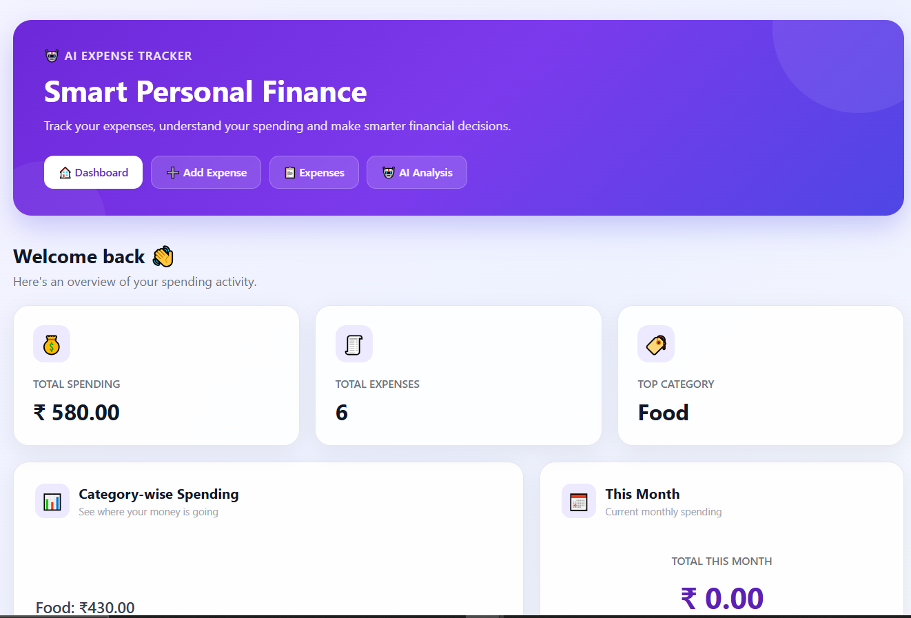
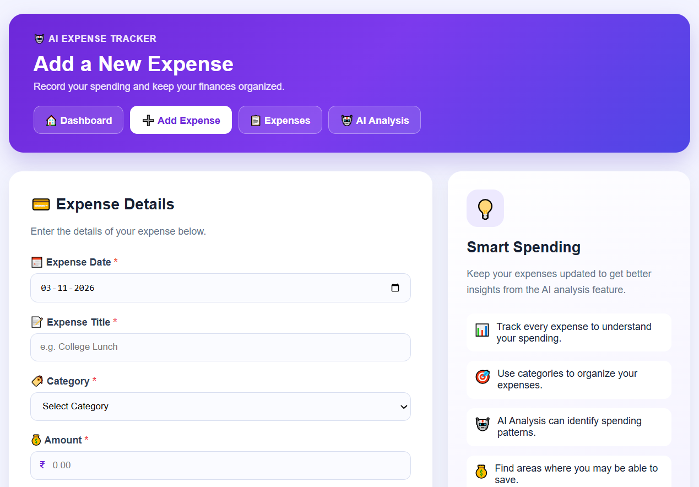
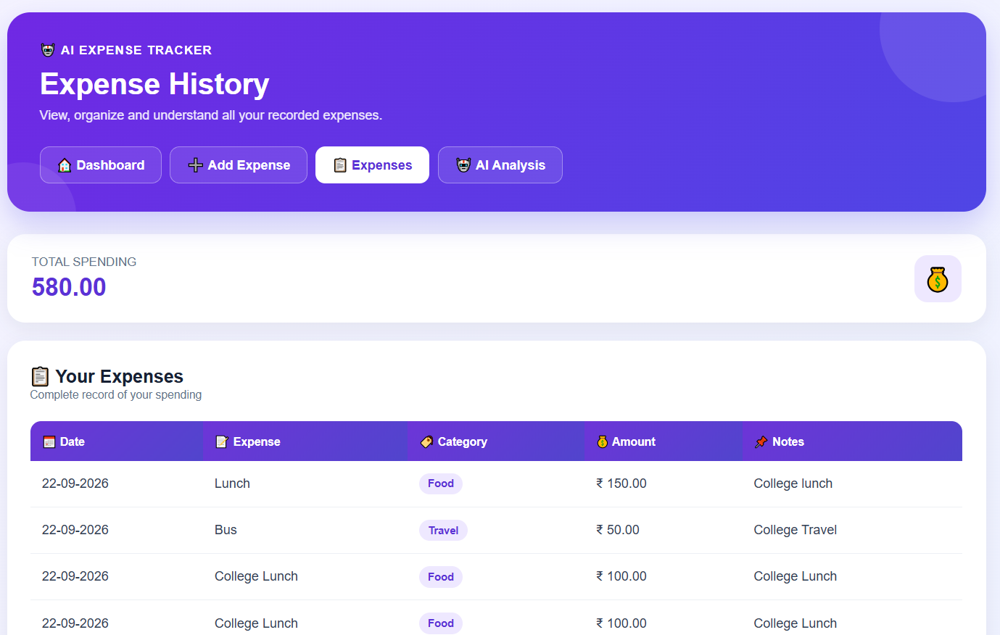
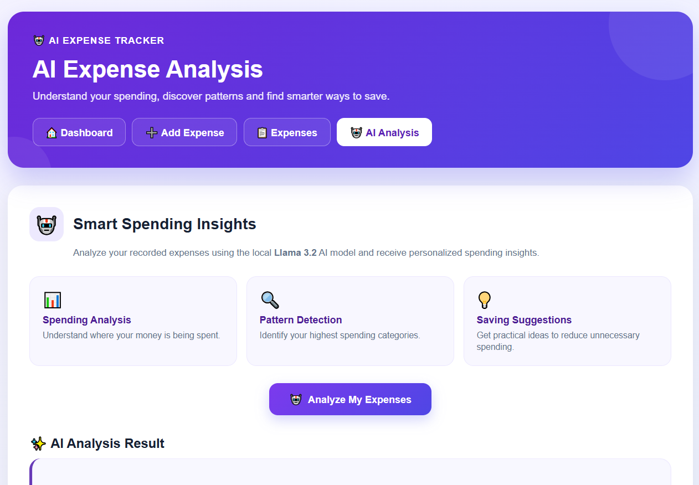

# AI-Integrated Personal Expense Tracker

An AI-powered personal expense management application developed using C# and ASP.NET Web Forms.

## Features
- Add and manage daily expenses.
- Categorize expenses.
- View monthly and category-wise spending.
- Dashboard for expense tracking.
- AI-powered expense analysis using Ollama and Llama 3.2 (3B).

## Technologies Used
- C#
- ASP.NET Web Forms
- .NET Framework 4.8
- SQL Server
- HTML, CSS
- Ollama
- Llama 3.2 (3B)

## Database
SQL Server – AIExpenseTrackerDB

## Developer
Sonali Dandapani Sethi

## Project Status
Academic project – source code uploaded to GitHub.
## Screenshots

### Dashboard

### Add Expense

### Expenses

### AI Analysis

